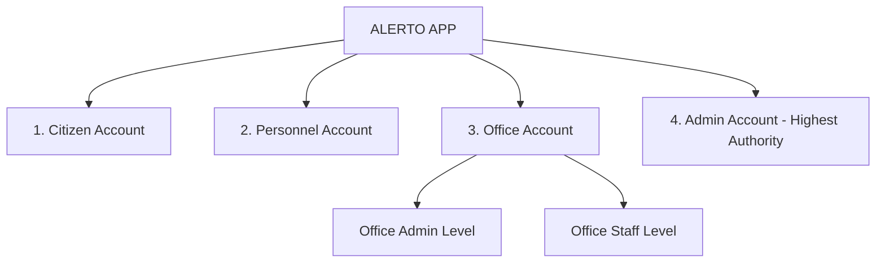

# ALERTO APP — Account & Permission Guide

## 1. Core Rule: The Four Account Types

ALERTO APP strictly defines **four main account types**. There is **NO Super Admin role** anywhere in the system architecture.

| Account Type | Target Stakeholder | Self-Registration | Primary Authorization Mechanism |
|---|---|---|---|
| `citizen` | General public / residents | Yes (Web portal) | Role `citizen` + Verified location pin |
| `personnel` | Responders (MDRRMO, BFP, PNP, EMS) | No (Admin provisioned) | Role `personnel` + `personnel_profiles` + Availability state |
| `office` | Agency departments & dispatch desks | No (Admin provisioned) | Role `office` + `office_users.office_level` (`office_admin` / `office_staff`) |
| `admin` | EOC command & system management | No (Provisioned via CLI / Seeder) | Role `admin` (Highest system authority) |

---

## 2. Office Permission Levels

Office accounts are **not** split into distinct `account_type` values. Instead, they share the `office` account type and define granular capabilities through the `office_users.office_level` attribute:

### A. Office Admin (`office_admin`)
- Full administrative authority within their assigned office/agency.
- Can manage agency personnel assignments and response teams.
- Can review and approve office dispatch reports.
- Can configure office jurisdictional parameters and contact info.

### B. Office Staff (`office_staff`)
- Operational dispatch authority.
- Can log incident updates and communicate with active response units.
- Read-only access to office configuration and rosters.

---

## 3. Personnel Availability Sub-states

Personnel accounts require an operational availability status before participating in emergency dispatches:

| Status Key | UI Indicator | Meaning |
|---|---|---|
| `available` (`online`) | Emerald / Active Ping | On-duty, GPS active, ready for emergency dispatch assignments. |
| `off_duty` (`offline`) | Slate / Neutral | Shift completed or unavailable. Unit will not be included in dispatch algorithms. |
| `dispatched` | Blue / Busy | Assigned to an active emergency incident; en route. |
| `on_scene` | Amber / Warning | Arrived at incident site; actively conducting emergency response operations. |
| `busy` | Red / Restricted | Temporarily unavailable for reassignment (e.g., patient transfer, decontamination). |

---

## 4. Role & Permission Matrix Reference

The system database stores granular permission assignments in the `permissions` and `role_permission` tables:

- `incident.create`, `incident.view`, `incident.cancel` (Citizen, Office, Admin)
- `incident.dispatch`, `incident.reassign`, `incident.escalate` (Office Admin, Office Staff, Admin)
- `incident.resolve`, `incident.close` (Office Admin, Admin)
- `personnel.manage`, `team.assign` (Office Admin, Admin)
- `system.configure`, `audit.view`, `user.manage` (Admin only)

