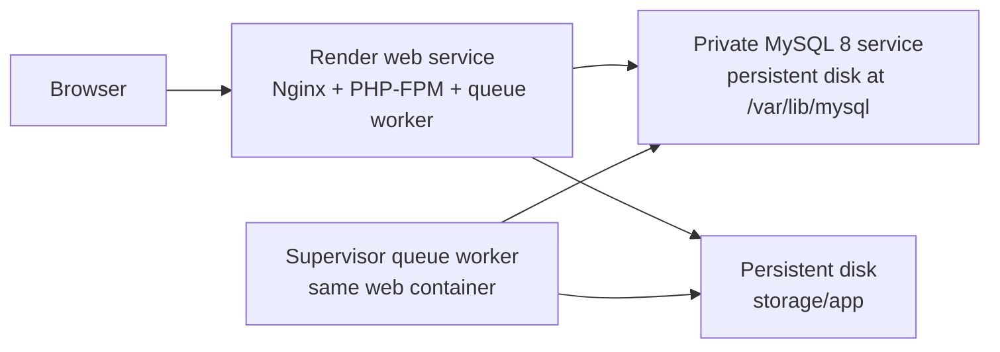

# ALERTO APP — Render Demo Deployment Guide

## Scope and current status

This guide prepares this duplicated project for a **testing/demo deployment only**. The Render Blueprint targets the existing `masterjabezx/ALERTO-APP-DEMO` repository, the `main` branch, Singapore, and a Render-provided `.onrender.com` URL.

No Render service or database has been created. No payment was requested. No migration, seeder, commit, or push was run.

The deployment files are [Dockerfile](../Dockerfile), [.dockerignore](../.dockerignore), [render.yaml](../render.yaml), [.env.render.example](../.env.render.example), and the [docker/](../docker/) startup configuration. The project has a Laravel health route at `/up`.

## Findings from the project

| Area | Detected configuration |
| --- | --- |
| Laravel / PHP | `composer.json` requires PHP `^8.3` and Laravel `^13.0`. Installed framework version is Laravel `13.43.0`. The image uses PHP `8.5` FPM. |
| Local database | Laravel is configured with `DB_CONNECTION=mysql`. The XAMPP server binary and the existing database implementation notes identify MariaDB `10.11.19`; no database process was running and port 3306 had no listener during inspection. |
| Database compatibility | The migrations use Laravel schema operations and MySQL-style `ALTER TABLE ... MODIFY COLUMN` statements for enums and column definitions. MySQL 8 documents this syntax. No MariaDB-only storage engine or function was found in the inspected app code. The Render database is a fresh, separate MySQL 8 database; no MariaDB data is copied or converted. A complete migration run on MySQL 8 remains required before deployment because a Docker/MySQL runtime was unavailable locally. See [MySQL ALTER TABLE](https://dev.mysql.com/doc/refman/8.0/en/alter-table.html). |
| PHP extensions | Laravel needs the standard `ctype`, `filter`, `hash`, `mbstring`, `openssl`, `session`, and `tokenizer` extensions. The PHP 8.5 base image supplies the core/fileinfo, cURL, mbstring, and POSIX modules. This app also uses PDO MySQL, EXIF, GD image derivatives, and PCNTL for its queue worker. The Docker build installs `pdo_mysql`, `exif`, `gd`, `pcntl`, `opcache`, `bcmath`, and `zip`. It also installs FFmpeg/FFprobe for video thumbnails and metadata. |
| Frontend | The lockfile installs Vite `7.3.8`. Vite requires Node `^20.19.0` or `>=22.12.0`; the local Node `24.19.0` meets that requirement. The image builds assets with Node 24 and `npm ci`. No `VITE_*` variable is referenced by the current JS/CSS entry points. |
| Queues | The app uses the database queue and has queued media and Facebook webhook jobs, plus `ShouldBroadcast` events. A queue worker is required. Supervisor runs it in the same Render web container as PHP-FPM and Nginx so media jobs can read the same persistent storage. |
| Reverb / Echo | `laravel/reverb` and `laravel-echo` are not installed. The Render config sets `BROADCAST_CONNECTION=null`; no Reverb service is included. |
| Scheduler | `routes/console.php` contains only Laravel’s default `inspire` command. No scheduled application task was found, so no scheduler service is included. |
| Uploads | The app stores private photos, videos, documents, message attachments, and derivatives on the local private disk. Default media limits are 15 MB for photos, 50 MB for videos, and 20 MB for documents. The web service has a 5 GB persistent disk mounted at `storage/app`; Nginx and PHP upload limits allow the app’s 50 MB video limit. |
| Environment keys | Deployment uses `APP_NAME`, `APP_ENV`, `APP_KEY`, `APP_DEBUG`, `APP_URL`, `LOG_CHANNEL`, `LOG_LEVEL`, `DB_*`, `CACHE_STORE`, `SESSION_DRIVER`, `SESSION_SECURE_COOKIE`, `QUEUE_CONNECTION`, `DB_QUEUE_RETRY_AFTER`, `FILESYSTEM_DISK`, `BROADCAST_CONNECTION`, `MAIL_MAILER`, and `BCRYPT_ROUNDS`. Secret values are not included here. |

`APP_ENV=production` is intentional for Laravel’s secure runtime behavior. The explicit app name and persistent page banner identify this as `ALERTO APP — TESTING ENVIRONMENT`.

## Render architecture



The Blueprint uses a private Render service for MySQL, with its data disk mounted at `/var/lib/mysql`. App DB host, port, and password are wired from that private service. MySQL has no public service endpoint. The MySQL image uses the documented Render self-hosted MySQL pattern; see [Deploy MySQL](https://render.com/docs/deploy-mysql).

Render persistent disks require paid services. The Blueprint selects a `1c-2g` web plan with a 5 GB media disk and a `0.5c-512mb` private MySQL plan with a 1 GB database disk. Review current pricing before creating the Blueprint. A disk-backed service is single-instance and does not support zero-downtime deploys; Render’s [persistent disk limitations](https://render.com/docs/disks#disk-limitations-and-considerations) apply.

The queue worker is co-located intentionally. `ProcessMediaAttachmentJob` reads uploaded source files from the app’s private disk. Render disks are attached to one service instance and are not shared with a separate worker service. If this demo later needs multiple app/worker instances, move file storage to a shared object store and install/configure its Laravel adapter first.

The Blueprint does not define a pre-deploy migration command. Migrations and seeders are deliberately manual.

## Demo safety and data protection

- A visible testing banner appears in all account portals, the public gateway, authentication/report pages, and the offline page. Report and SOS confirmations say they are test records, not real dispatches.
- Click-to-call links and hotline numbers are disabled or hidden in the demo UI. Dispatch confirmation copy says the action is simulated.
- Browser GPS capture is disabled in the demo JavaScript and by the Nginx `Permissions-Policy` header. Use synthetic coordinates for map/report testing.
- Preserve the existing five account types and their access restrictions: LDRRMO Super Admin, Admin — DIAL DAPH Command Center, Office, Personnel, and Citizen. No authorization code was changed.
- Use synthetic names, email addresses, phone numbers, locations, accounts, and incident records only. Do not import local XAMPP data, production backups, real citizen details, or real responder contacts.
- `MAIL_MAILER=log` prevents SMTP delivery. `BROADCAST_CONNECTION=null` prevents broadcasting to an external service. No SMS provider was found in the installed packages/configuration. Facebook Messenger credentials (`META_*`) are intentionally absent, so do not add real Meta credentials to this demo.
- The app’s existing `.env` is ignored by Git and is not copied into Docker. Current tracked files include the safe `.env.example`; no `.env`, SQL dump, database file, private key, or upload file is tracked. The `.gitignore` now covers local environment files, dumps, keys, uploads, logs, and caches. The Docker context additionally excludes environment files, backups, `vendor`, `node_modules`, private evidence, and generated caches.
- `.env.render.example` contains only safe placeholders. Render generates the stable APP_KEY and MySQL passwords. The entrypoint adds Laravel’s `base64:` prefix to Render’s generated APP_KEY value once at process startup; it never writes that key to the image or repository.

## Manual setup after review

1. Run the local checks listed below, then inspect the staged file list. Commit and push only after review. The local Git remote is already `origin` for `ALERTO-APP-DEMO`; the Blueprint has auto-deploy disabled.
2. In Render, connect the `masterjabezx/ALERTO-APP-DEMO` GitHub repository and select its `main` branch. Review the Singapore region, paid plans, and disk sizes before applying `render.yaml`.
3. Render generates `APP_KEY`, `MYSQL_PASSWORD`, and `MYSQL_ROOT_PASSWORD` on initial Blueprint creation. Those values remain in Render’s service environment. Do not copy them into `.env.render.example` or Git.
4. Let MySQL finish its initial startup. Use a Render Shell on the web service to review the pending migration SQL with `php artisan migrate --pretend`. Review every migration’s `up()` method; the history contains enum modifications and data updates, so use only the new, empty demo database. Then run `php artisan migrate --force` manually. Never run `migrate:fresh`, `db:wipe`, rollback, or a production seeder.
5. Create synthetic demonstration accounts and records only. Review `DevelopmentAccountSeeder` before deciding whether it is appropriate; no seeder is run by the Docker image or Blueprint.
6. Check the public `/up` endpoint, login with test accounts, queue processing, and upload persistence. Keep SMTP, SMS, Reverb/Pusher, and Meta credentials unset.

Render’s [Blueprint reference](https://render.com/docs/blueprint-spec) documents the service, image, disk, generated-secret, and cross-service environment references used here. The current CLI validation command is `render blueprints validate render.yaml` (Render CLI v2.7.0+).

## Local validation commands

Run from the project root in PowerShell:

```powershell
composer validate --strict
composer check-platform-reqs --no-dev
npm.cmd ci
npm.cmd run build
docker build --pull -t alerto-app-demo:testing .
render blueprints validate render.yaml
```

The Docker command verifies the multi-stage PHP/Node build. The Render CLI command validates YAML syntax, Blueprint schema, plan/region values, and service references. Neither command creates a Render service. Run the Artisan commands below only against the new Render demo database after reviewing the migration files:

```powershell
php artisan migrate --pretend
php artisan migrate --force
```

When ready to publish the reviewed project changes to GitHub, stage only the intended files and push manually:

```powershell
git add .gitignore .dockerignore Dockerfile render.yaml .env.render.example docker/ docs/ALERTO_APP_RENDER_DEPLOYMENT_GUIDE.md resources/js/app.js resources/js/demo-safety.js resources/views/admin/incidents/show.blade.php resources/views/admin/map/index.blade.php resources/views/citizen/contacts.blade.php resources/views/citizen/records.blade.php resources/views/citizen/success.blade.php resources/views/components/dual-hotlines.blade.php resources/views/components/demo-environment-banner.blade.php resources/views/components/layouts/admin.blade.php resources/views/components/layouts/citizen.blade.php resources/views/components/layouts/office.blade.php resources/views/components/layouts/personnel.blade.php resources/views/components/layouts/super-admin.blade.php resources/views/components/pwa-connection-indicator.blade.php resources/views/dashboards/citizen.blade.php resources/views/dashboards/personnel.blade.php resources/views/guest/confirmation.blade.php resources/views/guest/report.blade.php resources/views/guest/sos-confirmation.blade.php resources/views/guest/sos.blade.php resources/views/layouts/auth.blade.php resources/views/office/incidents/show.blade.php resources/views/pwa/offline.blade.php resources/views/welcome.blade.php
git diff --cached --check
git commit -m "Prepare ALERTO demo for Render"
git push origin main
```

## Validation limitation

At preparation time, Docker/Podman and the Render CLI were not installed. A temporary YAML parser successfully parsed `render.yaml`, and local checks confirmed its two Singapore services and in-Blueprint references. The Render CLI schema/semantic validator was unavailable, and the local MariaDB process was stopped. A Docker image build and full MySQL 8 migration run must still be completed before the setup is considered deployment-ready.
