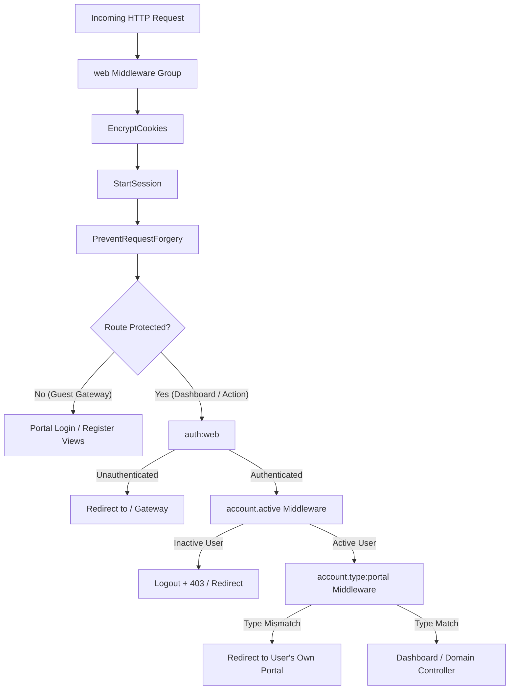

# ALERTO APP — Authentication & Security System Architecture

## 1. Overview & Architectural Principles

The ALERTO APP authentication architecture is designed for high reliability, fault isolation, and strict role demarcation. It supports four distinct stakeholder groups through specialized gateways:

- **Citizen:** Public incident reporting, real-time alert tracking, and emergency assistance requests.
- **Personnel:** Field emergency responders, paramedical teams, and rescue operatives requiring availability state management.
- **Office:** Government agency departments, emergency dispatchers, and operations centers (differentiated into Office Admin and Office Staff).
- **Admin:** System administrators and high-level incident coordination authorities (**Highest system authority; NO Super Admin exists**).

---

## 2. Authentication Guards & Session Management

- **Driver:** Stateful session authentication powered by Laravel 13 session handling and encrypted cookies.
- **Provider:** Eloquent user provider bound to `App\Models\User`.
- **Identity Fields:** Flexible login accepting either `email` (RFC compliant) or Philippine standard mobile numbers (`09XXXXXXXXX`).
- **Hash Algorithm:** Bcrypt via PHP's native password hashing API with cost factor 12.
- **Session Security:**
  - Session regeneration on login (`$request->session()->regenerate()`) to defend against session fixation attacks.
  - Session invalidation on logout (`$request->session()->invalidate()`) with CSRF token rotation.
  - Presence tracking: login and logout events automatically synchronize `user_presence` state.
  - Personnel status synchronization: Logging out automatically marks active personnel shifts as `off_duty` in `personnel_availabilities`.

---

## 3. Middleware Pipeline

### Registered Middleware
1. **`account.type` (`App\Http\Middleware\EnsureAccountType`)**:
   Ensures that an authenticated user's `account_type` matches the route group. If a Citizen attempts to view `/admin/dashboard`, they are redirected back to their own dashboard (`/citizen/dashboard`), preventing unauthorized cross-portal escalation.
2. **`account.active` (`App\Http\Middleware\EnsureActiveAccount`)**:
   Checks `user.is_active`. If an account has been suspended or deactivated by an administrator, the user is logged out immediately and redirected to the login gateway with an explanatory error.
3. **`redirectGuestsTo`**:
   Configured in `bootstrap/app.php` to route all unauthenticated requests to `route('home')` (`/`).

---

## 4. Rate Limiting & Throttling Defense

- **Throttle Scope:** Per username/phone and client IP: `Str::transliterate($login . '|' . $request->ip())`.
- **Max Attempts:** 5 failed attempts per 60-second window.
- **Lockout Action:** Subsequent attempts within the window return HTTP 302 redirect back with localized throttle message (`auth.throttle`) showing seconds remaining.
- **Audit Logging:** Every login attempt (success, failure, throttle) and logout event is logged to the `audit_logs` table with timestamp, IP address, user agent, and event type.

---

## 5. Automated Verification

The complete authentication test suite is located at `tests/Feature/AuthenticationTest.php` and runs against the live MariaDB database using `DatabaseTransactions`:
- 40 tests, 99 assertions, 100% passing.
- Validates rate limiting, password validation, guest redirection, cross-portal denial, personnel availability triggers, and full citizen registration with location pins.

