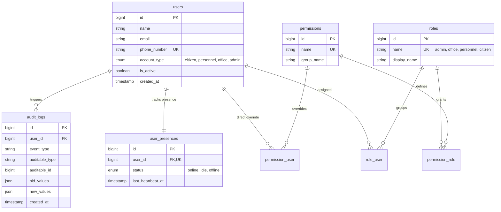
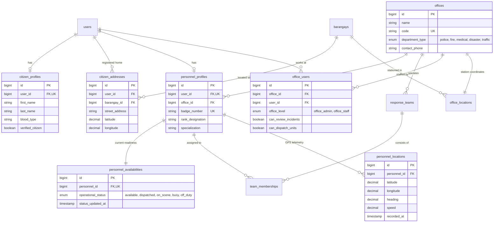
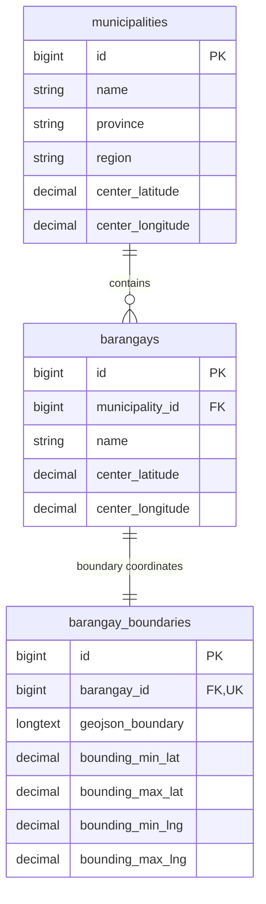
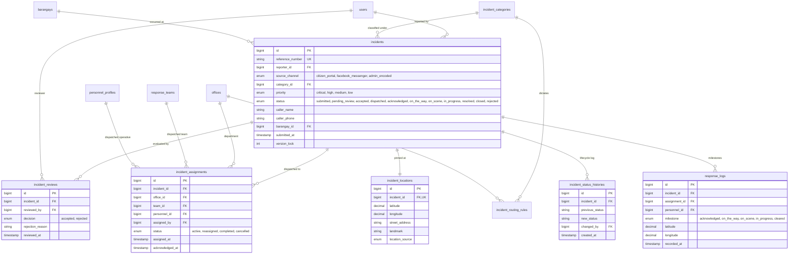
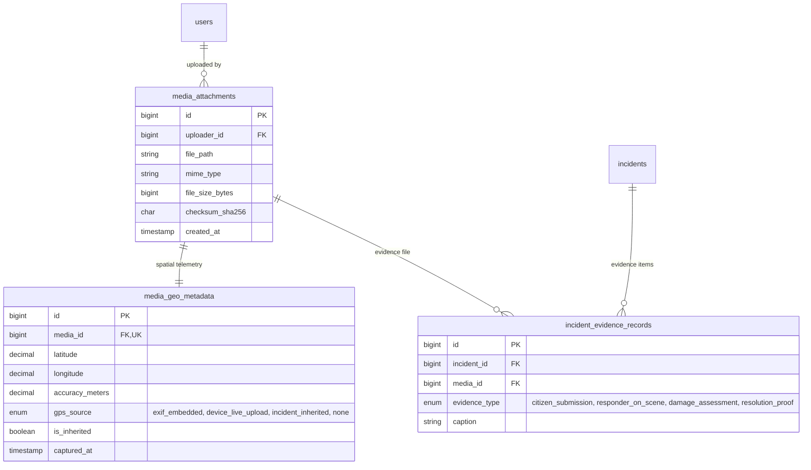
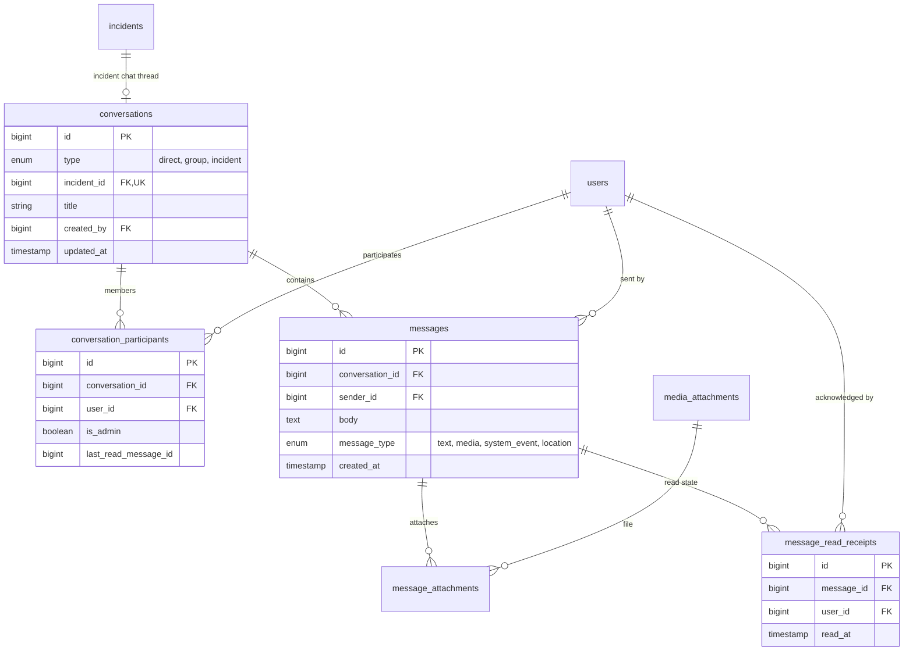
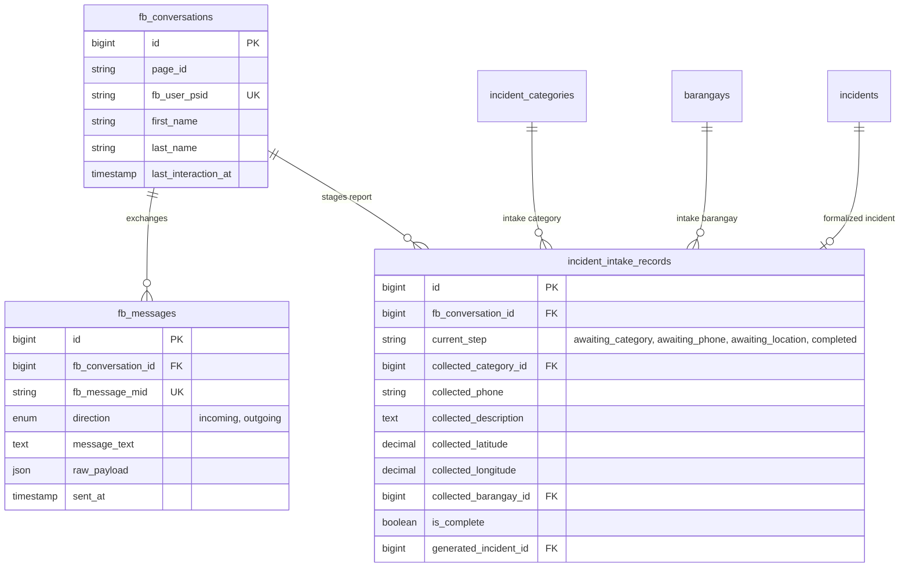
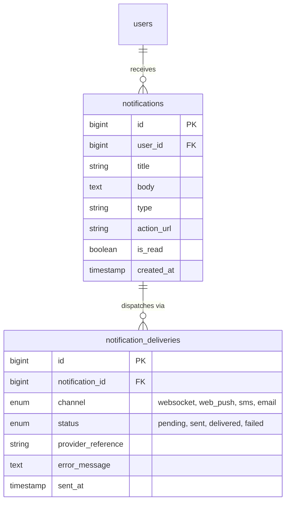

# ALERTO APP — Entity Relationship Diagrams (ERD)

This document visualizes the complete database architecture of ALERTO APP, partitioned into logical domain sub-diagrams for clarity and maintainability.

---

## 1. Core Authentication, Access Control & Auditing

---

## 2. Citizen, Personnel, & Office Profiles

---

## 3. Geographic Infrastructure

---

## 4. Incident Management, Lifecycle & Dispatch Routing

---

## 5. Media & Geo-Tagged Evidence

---

## 6. Internal Messenger System

---

## 7. Facebook Messenger Intake System

---

## 8. Multi-Channel Notification Pipeline

