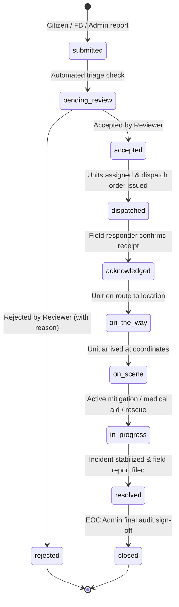

# ALERTO APP — Incident Lifecycle & Workflow Specification

## 1. Lifecycle State Machine

An incident progresses through eleven (11) distinct operational states:



---

## 2. State Transition Rules & Safeguards

### Rule 1: No Dispatch Before Review Acceptance
> [!IMPORTANT]
> **MANDATORY PREREQUISITE:** Under NO circumstance may an incident be dispatched directly from `submitted` or `pending_review`.
> An incident MUST be formally evaluated and transition to `accepted` by an authorized Admin or Office Admin before unit assignment.

### Rule 2: Concurrency & Duplicate Dispatch Protection
- When multiple dispatchers view the active queue simultaneously, race conditions are prevented using an **Optimistic Concurrency Lock** (`version_lock` column on `incidents`).
- Any update statement requires:
  ```sql
  UPDATE incidents 
  SET status = 'dispatched', version_lock = version_lock + 1 
  WHERE id = ? AND version_lock = ?;
  ```
- If the rows affected equals zero, the transaction rolls back with a `ConcurrencyException`, prompting the operator with the latest state.

### Rule 3: Rejection Audit Requirements
- Incidents evaluated as prank, spam, duplicate, or unverified can be transitioned to `rejected`.
- The database enforces that `rejection_reason` in `incident_reviews` cannot be null when decision is `'rejected'`.
- Citizens receive an automated polite notification regarding the status.

### Rule 4: Field Responder Operational Milestones
- As responders proceed, clicking status buttons records timestamps and GPS coordinates in `response_logs`:
  1. `acknowledged` — Responder views notification and clicks "Accept Mission".
  2. `on_the_way` — Unit departs base; live tracking active.
  3. `on_scene` — Unit arrives at incident scene; distance check verifies proximity.
  4. `in_progress` — Operation underway; live incident chat active.
  5. `resolved` — Mitigation completed; post-incident notes submitted.

