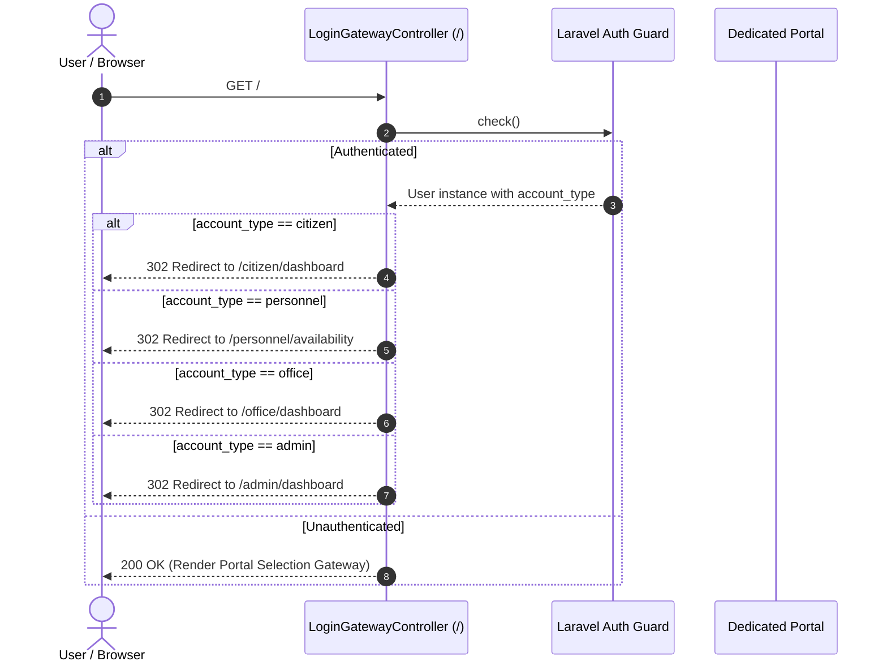
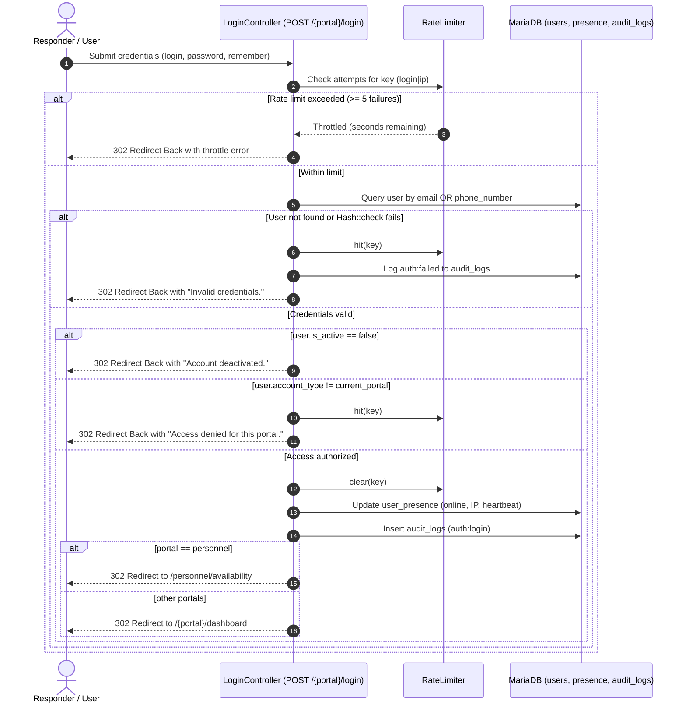
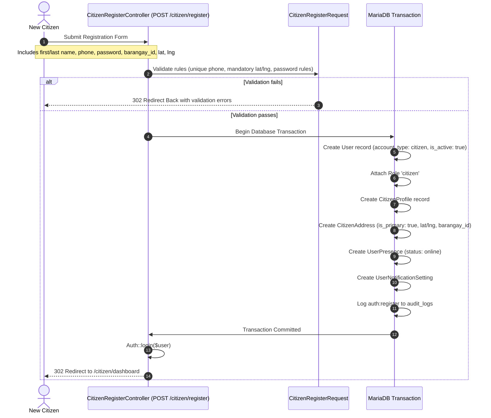

# ALERTO APP — Login & Registration Workflows

## 1. Landing Gateway Workflow

The main gateway is served at `/` (`route('home')`). If an authenticated user visits the gateway, they are automatically forwarded to their corresponding portal dashboard.

---

## 2. Dedicated Portal Login Workflow

Each account type accesses its dedicated login view (`/citizen/login`, `/personnel/login`, `/office/login`, `/admin/login`).

---

## 3. Citizen Registration & Mandatory Location Pinning

---

## 4. Personnel Availability Lifecycle

1. **Login:** Personnel enters valid credentials at `/personnel/login`.
2. **Intermediate Gateway:** Routed directly to `/personnel/availability`.
3. **Selection:**
   - **ONLINE (`available`):** Sets status to `available`, opens a new record in `availability_sessions` with `shift_started_at`. Responders are now discoverable for emergency dispatches.
   - **OFFLINE (`off_duty`):** Sets status to `off_duty`, closes any active session in `availability_sessions` with `shift_ended_at`.
4. **Logout:** If personnel signs out via `POST /logout`, the `LoginController` automatically sets their availability to `off_duty` to ensure units are never left as ghost responders.

