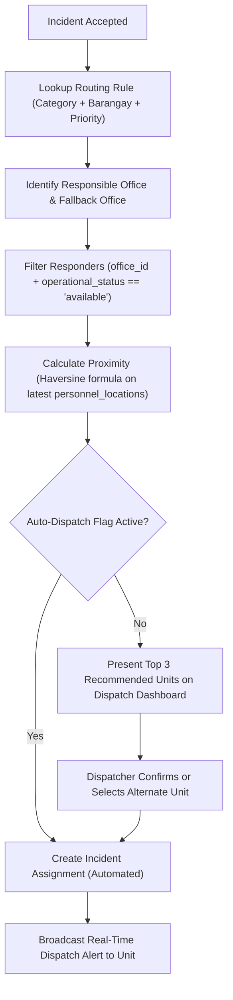

# ALERTO APP — Automatic & Manual Incident Routing Engine

## 1. Routing Engine Principles
The ALERTO APP dispatch routing engine matches incoming, verified emergencies with the most appropriate, available, and geographically closest response units while guaranteeing:
1. **Deterministic Rule Evaluation:** Transparent matching based on category, jurisdiction, and priority.
2. **Availability Filtering:** Only units in `operational_status = 'available'` and on an active duty session are recommended.
3. **Manual Override Supremacy:** Operators retain full authority to re-assign or multi-assign units.
4. **Duplicate Dispatch Prevention:** Active assignments are enforced via atomic database locks.

---

## 2. Multi-Stage Recommendation Algorithm



---

## 3. Spatial Proximity Calculation (Haversine SQL)

When calculating distance between an incident coordinate `($lat, $lng)` and available personnel:

```sql
SELECT 
    p.id AS personnel_id,
    p.badge_number,
    u.name AS officer_name,
    t.call_sign,
    loc.latitude,
    loc.longitude,
    ( 6371 * acos(
        cos( radians(?) ) * cos( radians( loc.latitude ) ) 
        * cos( radians( loc.longitude ) - radians(?) ) 
        + sin( radians(?) ) * sin( radians( loc.latitude ) ) 
    ) ) AS distance_km
FROM personnel_profiles p
JOIN users u ON u.id = p.user_id
JOIN personnel_availabilities a ON a.personnel_id = p.id
LEFT JOIN team_memberships tm ON tm.personnel_id = p.id
LEFT JOIN response_teams t ON t.id = tm.team_id
JOIN personnel_locations loc ON loc.personnel_id = p.id 
    AND loc.id = (
        SELECT MAX(id) FROM personnel_locations WHERE personnel_id = p.id
    )
WHERE p.office_id = ?
  AND a.operational_status = 'available'
ORDER BY distance_km ASC
LIMIT 5;
```

---

## 4. Concurrency & Race Condition Elimination

To prevent two dispatchers from assigning the same personnel simultaneously to two different incidents:

```php
DB::transaction(function () use ($incidentId, $personnelId, $officeId, $assignedBy) {
    // 1. Lock personnel availability record
    $availability = PersonnelAvailability::where('personnel_id', $personnelId)
        ->lockForUpdate()
        ->firstOrFail();

    if ($availability->operational_status !== 'available') {
        throw new UnitUnavailableException("Personnel is no longer available.");
    }

    // 2. Create official assignment
    IncidentAssignment::create([
        'incident_id' => $incidentId,
        'office_id' => $officeId,
        'personnel_id' => $personnelId,
        'assigned_by' => $assignedBy,
        'status' => 'active',
        'assigned_at' => now(),
    ]);

    // 3. Mutate status to dispatched
    $availability->update([
        'operational_status' => 'dispatched',
        'status_updated_at' => now(),
    ]);
});
```

